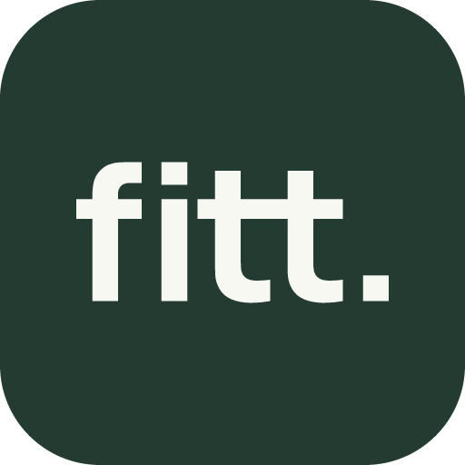
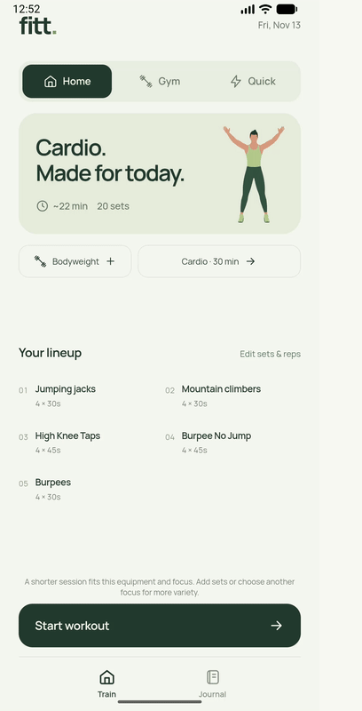
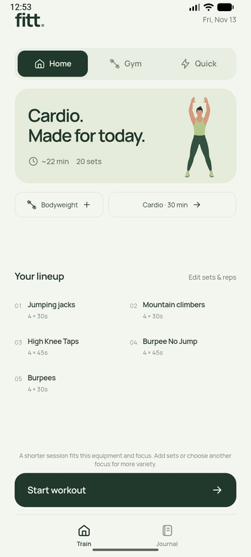

# fitt

<p align="center"></p>

## Screens

| Training flow | Custom setup |
|---|---|
|  |  |

## Run

```powershell
yarn
yarn tauri android dev
```

Desktop: `yarn tauri dev`. Browser preview: `yarn dev` (not a substitute for Android WebView verification).

Build an emulator-compatible debug APK:

```powershell
yarn tauri android build --debug --target x86_64 --apk --ci
```

Stop an existing Android dev command before building; Tauri holds an Android project lock while dev runs. For a physical ARM64 phone use `--target aarch64` instead.

## Experience

- **Train:** Home / Gym / Quick each remember their own available equipment, focus, duration and target preferences. Equipment is only shown when you choose to configure it; switching locations never prompts you again. Add or remove equipment through the Equipment control.
- **Plan:** choose Cardio, Full body, Arms, Shoulders, Chest, Back, Legs, Core or Mobility and a 10/15/20/30/45-minute session. The offline planner matches every required piece of equipment (including benches, racks and specific machines), selects relevant movements, and estimates actual time including rests and both sides. Estimates cover active time only and are not calorie predictions. When a combination supports less volume, the UI shows the shorter estimate rather than inventing exercises.
- **Targets:** Edit sets & reps before starting; preferences persist per location and movement. Recommended targets remain visible alongside your custom working amounts. During training, + Set adds another set to the current exercise. Extra in-session sets are logged for that workout; use the editor to change future set counts.
- **Workout:** local vector demonstrations, session progress, current-set ring, fixed recommendation and editable actual count. Timed moves have a start/pause timer. Partial sets adjust the next matching set without rewriting the recommendation. Additional sets retain unique set indices and are included in the journal.
- **Rest:** deadline-based countdown and next move; skip when ready.
- **Journal:** local-week activity, totals and paginated sessions. Tap a session for per-set planned/actual amounts. No points, badges or leaderboards.
- Leaving a workout offers Resume, save logged sets, or discard. Unperformed sets are never saved as completed.

The primary screens fit 370×740 and the connected emulator viewport without page scrolling. Very short displays, enlarged text and detail sheets may scroll rather than hide controls. Journal history is paginated.

## Offline and data

The entire app works offline: plans, 96 exercise demonstrations, cues, icons and the Manrope font are bundled. There are no YouTube embeds, remote media URLs or connectivity-dependent demos. The catalog supports bodyweight, bands, dumbbells, barbells, suspension trainers, cable stations, specific strength/cardio machines, stretching and foam rolling. Bodyweight is always available; selecting dumbbells never silently grants access to a bench or rack. Only matching muscles and movement types are eligible for each focus.

Workouts use the existing `fitt-v1` localStorage journal. Saved Home/Gym/Quick equipment and settings live separately under `fitt-workout-profiles-v1`; updating the APK with `adb install -r` preserves both. Active workouts remain in memory. Uninstalling or clearing app storage removes local data. There is no account or cloud sync.

Plank uses frame 0 of Low Plank Leg Raise as a static form reference. Dumbbell squats and Romanian deadlifts replace goblet squats and bench hops. Historical results keep their original names and units and never affect replacement exercises' targets.

Animations use the SVG-only light build of `lottie-web`, pause when hidden/offscreen, offer a pause control, and show a static pose under `prefers-reduced-motion`. Only the selected asset is loaded. User-supplied `vfe/Men` sources are unchanged. Edit `scripts/catalog.mjs` to extend the curated equipment-backed catalog, then run `node scripts/prepare-animations.mjs` to regenerate themed assets and `src/data/catalog.js`. Clothing/equipment use the forest/sage palette; skin tones are preserved. Confirm the supplied library's redistribution rights before public distribution.

The original exercise data structure was informed by [workout-cool](https://github.com/Snouzy/workout-cool). Its online services are not used at runtime.

## Checks

```powershell
node --test src/training.test.js src/planner.test.js
yarn build
```

Regression coverage includes equipment/muscle constraints across supported options, deterministic generation, duration-dependent workload, custom targets, extra sets, partial-set adaptation and historical data preservation. `src/planner.js` owns generation, `src/profiles.js` owns saved location settings, `src/training.js` owns session transitions and `src/store.js` owns journal persistence.

## Design references and credits

The replacement layouts were informed by screenshots from the official App Store listings for [Ladder](https://apps.apple.com/us/app/id1502936453), [Headspace](https://apps.apple.com/us/app/id493145008), [Flo](https://apps.apple.com/us/app/id1038369065) and [stoic](https://apps.apple.com/us/app/id1312926037). No screenshots or artwork from those products ship in this app. Hero illustrations and matching exercise demonstrations use the locally supplied vector animation library, recolored for fitt. No Mobbin access was available.

The `fitt.` launcher icon is outlined from the bundled Manrope font. After editing `src-tauri/app-icon.json` or its SVG layers, regenerate platform assets with `yarn tauri icon src-tauri/app-icon.json`.

Manrope is bundled under the SIL Open Font License; see `src/assets/fonts/OFL.txt`. Earlier interface work used the Unslop method by [Damir Sokolovsky (@heydamir)](https://heydamir.design/unslop), CC BY 4.0.
